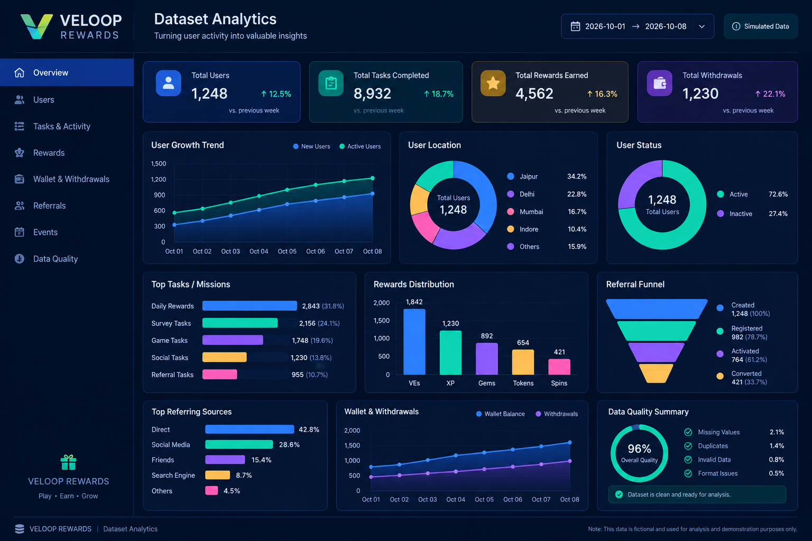
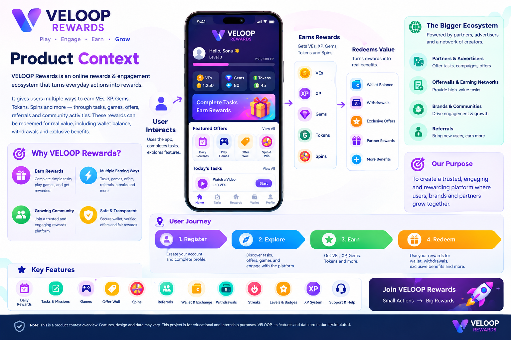
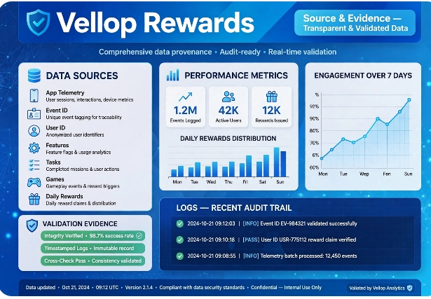
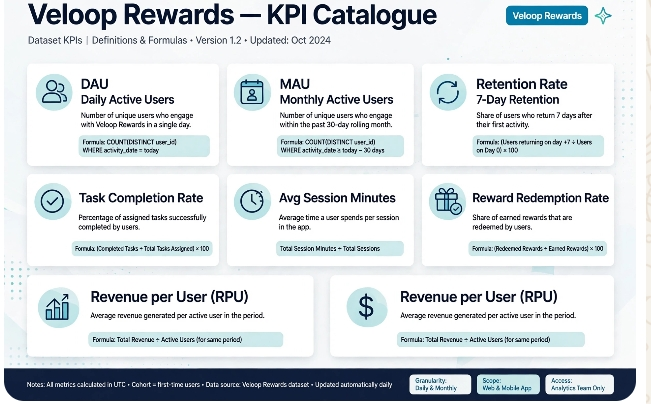
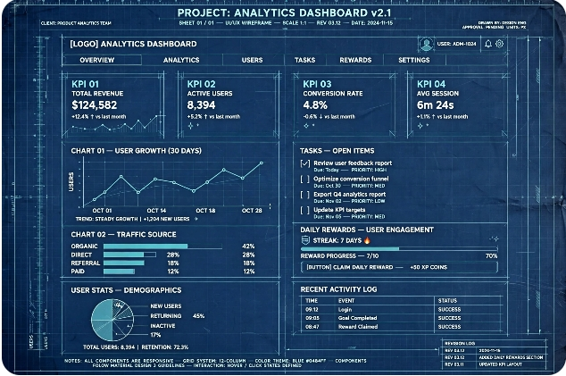
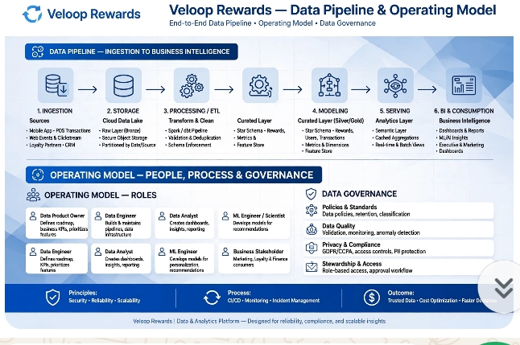
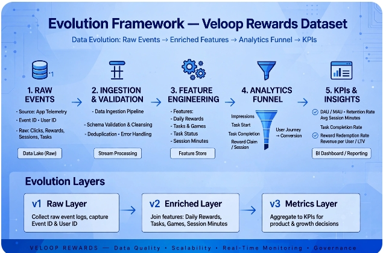
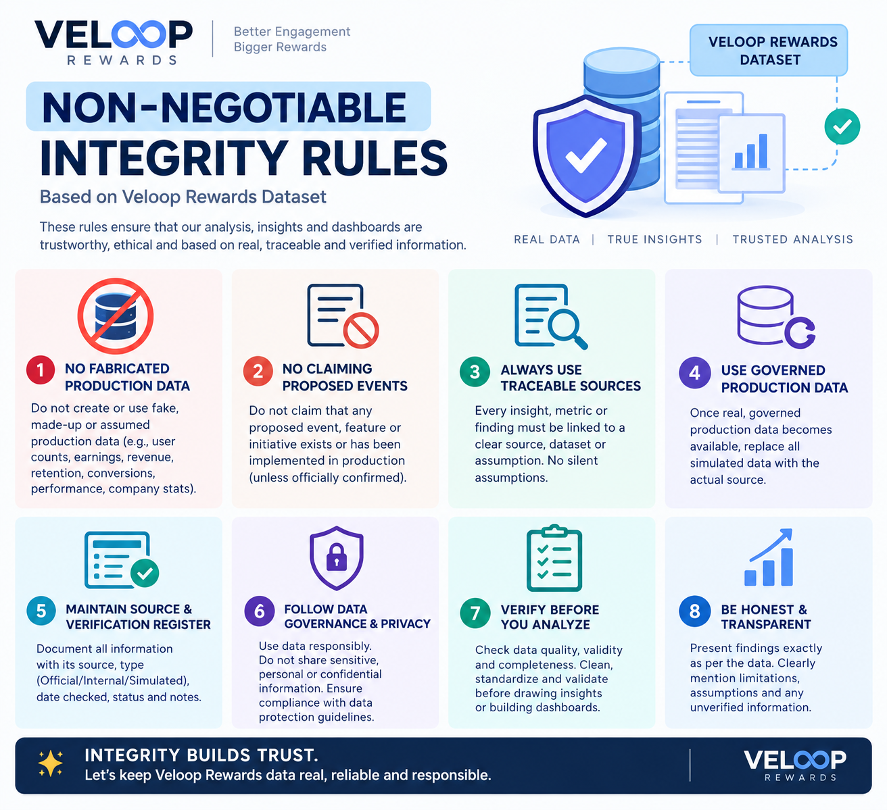
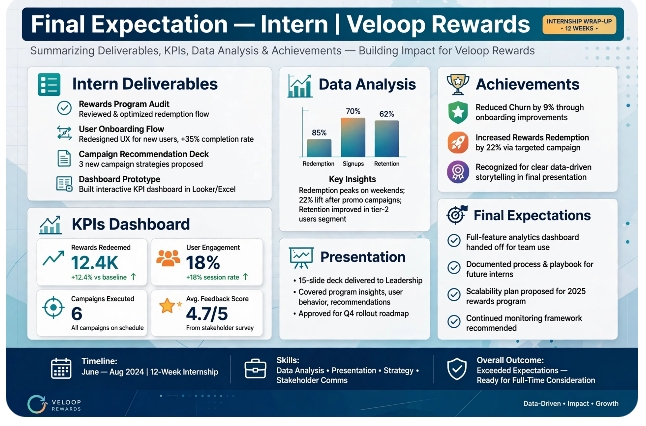

#  VELOOP REWARDS
# Product Analytics, Data Readiness & Data Management Blueprint
# 01_Product_Analytics/

# VELOOP Rewards — Product Overview

# 1. Introduction

VELOOP Rewards is a developing online rewards and engagement ecosystem designed to encourage users to participate in different activities and interact with the platform.

The product may include earning activities, daily rewards, streaks, missions, referrals, virtual currencies, levels, and wallet-related functionality.

Important: This document describes the product context for an analytics assignment. The dataset provided for this project is simulated and must not be treated as actual VELOOP user or transaction data.

# 2. Product Objective

The main objective of VELOOP Rewards is to create an engaging user experience by encouraging participation, rewarding eligible activities, and motivating users to return to the platform.

From a data analytics perspective, the objective is to understand user engagement, activity completion, reward distribution, retention, and wallet-related activity using the supplied simulated dataset.

# 3. Target Users

Potential user groups may include:

- New users registering on the platform.
- Active users participating in earning activities.
- Users completing tasks and missions.
- Users participating in daily rewards and streaks.
- Users referring other people to the platform.
- Users interacting with wallets and reward exchange features.

These are illustrative user groups, not confirmed real-user segments.

# 4. Main Product Features

# 4.1 User Accounts

Support user registration and account-related activities.

# 4.2 Earning Activities and Tasks

Allow users to participate in activities or complete tasks that may qualify for rewards.

# 4.3 Daily Rewards and Streaks

Encourage regular participation through daily reward opportunities and consecutive-day activity.

# 4.4 Missions and Badges

Provide goals and achievement indicators that can motivate user engagement.

# 4.5 Levels and XP

Track user progression through experience points (XP) and levels.

# 4.6 Virtual Currencies

The product context includes VEs, XP, Gems, Tokens, and Spins. Their exact definitions, conversion rules, and business logic must be confirmed from official product documentation.

# 4.7 Referrals

Support referral-related activities that may help encourage user acquisition.

# 4.8 Wallet and Exchange

Provide wallet-related functionality and possible reward exchange operations.

# 4.9 Withdrawals

Support withdrawal-related functionality, subject to the product's actual rules and availability.

# 5. User Journey

A possible illustrative user journey is:

1. A user creates an account.
2. The user explores available activities.
3. The user completes an eligible task or mission.
4. The platform records the activity.
5. Eligible rewards or progression points may be credited.
6. The user returns for daily rewards or additional activities.
7. The user may interact with wallet, exchange, or withdrawal features if available.

This journey is a working model for analysis, not confirmation of the live product workflow.

# 6. Product Analytics Objectives

The analysis will focus on the following areas:

- User registration and activity patterns.
- Daily and overall engagement.
- Task and mission completion.
- Reward and virtual-currency activity.
- Daily reward and streak participation.
- Referral activity.
- Wallet, exchange, and withdrawal records.
- Missing values, duplicate records, inconsistent formats, and other data-quality issues.

Only metrics supported by the supplied dataset will be calculated.

# 7. Key Performance Indicators (KPIs)

Potential KPIs include:

KPI| Purpose
Total Users| Count users represented in the dataset
Active Users| Measure users active during a defined period
Task Completion Rate| Measure completed tasks against eligible tasks
Daily Reward Participation| Measure participation in daily rewards
Streak Participation| Measure participation in streak activities
Referral Activity| Understand referral participation
Total Recorded Rewards| Summarize rewards represented in the dataset
Withdrawal Completion Rate| Measure completed withdrawals against eligible withdrawal requests

KPI definitions, denominators, time periods, and required columns must be validated before calculation.

# 8. Data Authenticity and Limitations

The dataset supplied for this assignment is fictional or simulated.

Therefore:

- Do not describe dataset records as actual VELOOP users.
- Do not report simulated rewards or withdrawals as real financial activity.
- Label charts, dashboards, KPIs, and findings as simulated or illustrative.
- Document assumptions whenever product behavior or field meanings are unknown.
- Do not assume that a feature is live or available unless supported by official product information.
- 
# 5. PRODUCT CONTEXT
# Click Link > Click view raw > Download in  File**************************
https://github.com/sonu633/VELOOP-REWARDS-TASK-01/blob/main/VELOOP_Product_Context_Brief.docx

# 6. SOURCE & EVIDENCE DISCIPLINE
# Click Link > Click view raw > Download in  File**************************
https://github.com/sonu633/VELOOP-REWARDS-TASK-01/blob/main/VELOOP_Source_and_Verification_Register.docx

# 7. WORK PACKAGE A — PRODUCT DATA READINESS AUDIT
# Click Link > Click view raw > Download in  File**************************
https://github.com/sonu633/VELOOP-REWARDS-TASK-01/blob/main/VELOOP_Work_Package_A_Data_Readiness_Audit.xlsx

# 8. WORK PACKAGE B — USER & ACCOUNT ANALYTICS SPECIFICATION
# Click Link > Click view raw > Download in  File**************************
https://github.com/sonu633/VELOOP-REWARDS-TASK-01/blob/main/analytics_change_dashboard.xlsx

# 9. Conclusion

This product overview establishes the initial context for the VELOOP Rewards analytics project. It will guide product-area mapping, dataset inventory, data-readiness auditing, data modeling, KPI definition, and subsequent analysis.

All findings will be based on the available evidence and clearly documented assumptions.

# Click this link > Click view raw > Download in File *************

https://github.com/sonu633/VELOOP-REWARDS-TASK-01/blob/main/Product_Area_map.xlsx
https://github.com/sonu633/VELOOP-REWARDS-TASK-01/blob/main/Source_Verification_Register.xlsx
# 02_Data_Readiness_Audit/

https://www.kaggle.com/code/sonubit/veloop-simulation-dataset-analysis

https://www.kaggle.com/code/sonubit/veloop-reward-dataset

# 03_Analytics_Specifications/
User_Analytics_Specification.xlsx
Earning_Reward_Specification.xlsx
Wallet_Withdrawal_Specification.xlsx
Referral_Engagement_Specification.xlsx
# 04_Data_Model/
Data_Dictionary.xlsx
ER_Diagram.png
# 10. WORK PACKAGE D — WALLET & WITHDRAWAL ANALYTICS
# Click Link > Click view raw > Download in  File**************************
https://github.com/sonu633/VELOOP-REWARDS-TASK-01/blob/main/Wallet_Withdrawal_Analytics.xlsx
# 11. WORK PACKAGE E — REFERRAL & ENGAGEMENT ANALYTICS
# Click Link > Click view raw > Download in  File**************************
https://github.com/sonu633/VELOOP-REWARDS-TASK-01/blob/main/Referral_Engagement_Analytics.xlsx

# 12. WORK PACKAGE F — PRODUCTION EVENT TRACKING PLAN
# Click Link > Click view raw > Download in  File**************************
https://github.com/sonu633/VELOOP-REWARDS-TASK-01/blob/main/Veloop_Event_Tracking_Plan.xlsx

# 13 WORK PACKAGE G — VELOOP DATA DICTIONARY
# Click Link > Click view raw > Download in  File**************************
https://github.com/sonu633/VELOOP-REWARDS-TASK-01/blob/main/Veloop_Data_Dictionary.xlsx
# 14. WORK PACKAGE H — LOGICAL DATA MODEL
# Click Link > Click view raw > Download in  File**************************
https://github.com/sonu633/VELOOP-REWARDS-TASK-01/blob/main/Logical%20model.docx

# 15. WORK PACKAGE I — KPI CATALOGUE
# Click Link > Click view raw > Download in File ******†********************
https://github.com/sonu633/VELOOP-REWARDS-TASK-01/blob/main/Kpi%20Catalogue.docx
# 16 WORK PACKAGE J — SIMULATED DATA PROFILING
# Click Link > Click view raw > Download in File ******†********************
https://github.com/sonu633/VELOOP-REWARDS-TASK-01/blob/main/rewards_app_dataset.xlsx
# 17. WORK PACKAGE K — DATA QUALITY AUDIT
# Click Link > Click view raw > Download in File ******†********************
https://github.com/sonu633/VELOOP-REWARDS-TASK-01/blob/main/rewards_app_dataset.xlsx
# 18. WORK PACKAGE L — DATA QUALITY CONTROL FRAMEWORK
# Click Link > Click view raw > Download in File ******†********************
https://github.com/sonu633/VELOOP-REWARDS-TASK-01/blob/main/Quality_Control_Framework.xlsx

# 19.WORK PACKAGE M — ANALYTICS DASHBOARD BLUEPRINT

# Click Link > Click view raw > Download in  File*********************#
# 1. Executive Overview
User activity, engagement, rewards, wallet, withdrawals and referrals

https://github.com/sonu633/VELOOP-REWARDS-TASK-01/blob/main/Platform_Performance_Dashboard.xlsx

# 2. User Analytics
Registrations, active users, acquisition, devices and lifecycle

https://github.com/sonu633/VELOOP-REWARDS-TASK-01/blob/main/User_Dashboard%20(1).xlsx
  

# 3. Engagement
Feature usage, task starts, completions and repeat activity

https://github.com/sonu633/VELOOP-REWARDS-TASK-01/blob/main/User_Engagement_Dashboard.xlsx

# 4. Rewards
reward activity  ,reward source  ,reward status , reward trends ,reversal activity

https://github.com/sonu633/VELOOP-REWARDS-TASK-01/blob/main/User_Engagement_Dashboard.xlsx

# 5. Wallet
Credits, redemptions, reversals and transaction trends

https://github.com/sonu633/VELOOP-REWARDS-TASK-01/blob/main/Wallet_Transactions_Dashboard.xlsx

# 6. Withdrawals
Requests, statuses, processing time and payout methods

https://github.com/sonu633/VELOOP-REWARDS-TASK-01/blob/main/Withdrawals_Dashboard.xlsx

# 7. Referrals
Referral creation, registrations, activations and conversion
# 20 . WORK PACKAGE N — DEVELOPER ANALYTICS HANDOFF

https://github.com/sonu633/VELOOP-REWARDS-TASK-01/blob/main/Referrals_Dashboard.xlsx

# 21.WORK PACKAGE O — DATA PIPELINE & OPERATING MODEL
# Click Link > Click view raw > Download in  File**************************
https://github.com/sonu633/VELOOP-REWARDS-TASK-01/blob/main/Data%20pipeline%20%26%20Operating%20model.docx
# 22 .WORK PACKAGE P — DATA ACCESS, PRIVACY & GOVERNANCE
# Click Link > Click view raw > Download in  File**************************
https://github.com/sonu633/VELOOP-REWARDS-TASK-01/blob/main/WORK%20PACKAGE%20P%20%E2%80%94%20DATA%20ACCESS%2C%20PRIVACY%20%26%20GOVERNANCE.docx
# 23. WORK PACKAGE Q — ANALYTICS CHANGE MANAGEMENT
# Click Link > Click view raw > Download in  File**************************
https://github.com/sonu633/VELOOP-REWARDS-TASK-01/blob/main/analytics_change_dashboard.xlsx

# 32. DEFINITION OF DONE
# Click Link > Click view raw > Download in  File**************************
https://github.com/sonu633/VELOOP-REWARDS-TASK-01/blob/main/VELOOP%20Analytics%20Definition%20Package%20(Draft%2C%20Assumption-Based).docx

# 33 	EVALUATION FRAMEWORK 
# Click Link > Click view raw > Download in  File**************************
https://github.com/sonu633/VELOOP-REWARDS-TASK-01/blob/main/EVALUATION%20FRAMEWORK.docx
# 34 NON-NEGOTIABLE INTEGRITY RULES
# Click Link > Click view raw > Download in  File**************************
https://github.com/sonu633/VELOOP-REWARDS-TASK-01/blob/main/NON-NEGOTIABLE%20INTEGRITY%20RULES.docx

# 35. FINAL EXPECTATION TO THE INTERN
# Click Link > Click view raw > Download in  File**************************
https://github.com/sonu633/VELOOP-REWARDS-TASK-01/blob/main/FINAL%20EXPECTATION%20TO%20THE%20INTERN.docx

